
<a href="https://enercoruna-gif.github.io/disenomd/">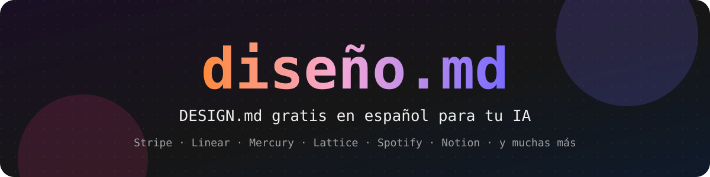</a>

     

<h3 align="center">Copia el estilo de las webs que te gustan y haz que tu IA lo respete en cada pantalla.</h3>

<a href="https://enercoruna-gif.github.io/disenomd/"><b>🌐 Abrir la web</b></a> · <a href="https://enercoruna-gif.github.io/disenomd/webs/"><b>📚 Ver las 68 webs</b></a> · <a href="https://enercoruna-gif.github.io/disenomd/kits/"><b>🎁 Kits</b></a> · <a href="https://enercoruna-gif.github.io/disenomd/como-usar/"><b>❓ Cómo se usa</b></a>

## 🎁 Packs de pago

Pago único en Payhip. Detalles de cada uno en la [página de kits](https://enercoruna-gif.github.io/disenomd/kits/).

| Pack | Qué es | Precio | |
|---|---|:-:|:-:|
| **[Kit Web Inicial](https://enercoruna-gif.github.io/disenomd/kits/#web)** | Tu web casi terminada: cambia textos y fotos |  | [Comprar](https://payhip.com/b/zXyEs) |
| **[Kit App Móvil](https://enercoruna-gif.github.io/disenomd/kits/#app)** | Tu app para iPhone y Android, ya empezada |  | [Comprar](https://payhip.com/b/8sAFS) |
| **[Pack Prompts e Instrucciones](https://enercoruna-gif.github.io/disenomd/kits/#prompts)** | Instrucciones listas para tu IA |  | [Comprar](https://payhip.com/b/MoOeS) |
| **[Pase del catálogo](https://enercoruna-gif.github.io/disenomd/kits/#pase)** | Todos los DESIGN.md de pago en un solo pase |  | [Comprar](https://payhip.com/b/TmsD6) |
| **[Fondos animados](https://enercoruna-gif.github.io/disenomd/kits/#fondos)** | Fondos en movimiento para tu web, listos para pegar |  | [Comprar](https://payhip.com/b/APUh4) |
| **[Plantillas de vídeo](https://enercoruna-gif.github.io/disenomd/kits/#videos)** | Vídeos para redes y web con tu marca |  | [Comprar](https://payhip.com/b/mOwWv) |
| **[DESIGN.md a medida](https://enercoruna-gif.github.io/disenomd/kits/#a-medida)** | Un DESIGN.md hecho para tu marca o tu web |  | [Comprar](https://payhip.com/b/kYZU0) |
| **[Estilos por sector](https://enercoruna-gif.github.io/disenomd/kits/#sectores)** | 45 estilos originales para negocios de aquí |  | [Comprar](https://payhip.com/b/bXiQf) |

---

## ⚡ En 30 segundos

1. **Elige** una web cuyo estilo te guste en la [web del catálogo](https://enercoruna-gif.github.io/disenomd/).
2. **Copia** su DESIGN.md con un toque, también desde el móvil.
3. **Pégalo** en tu IA junto a tu petición: *«Hazme la web de mi negocio siguiendo este DESIGN.md»*.

Saldrá con una paleta, dos tipografías y los mismos botones en todas las páginas, en lugar de colores al azar en cada sección.

## 🧩 ¿Qué es un DESIGN.md?

Es un archivo de texto con el sistema de diseño de una web: **colores, tipografías, radios, espaciados y componentes**, escrito para que un agente de IA lo lea y lo aplique. Sigue el [formato abierto de Google](https://github.com/google-labs-code/design.md), así que funciona igual en cualquier herramienta.

Cada análisis de este repositorio lo hemos hecho nosotros: visitamos la web, hacemos la captura, extraemos sus colores y letras y escribimos en español qué la hace reconocible.

## 🛠️ Dónde funciona

| Para crear webs con IA | Agentes de código | Chats |
|---|---|---|
| Lovable · v0 · Bolt · Framer · Webflow | Claude Code · Cursor · Codex · Copilot · Windsurf | ChatGPT · Claude · Gemini |

En los agentes de código basta con guardar el archivo como `DESIGN.md` en la raíz del proyecto y pedir *«sigue el DESIGN.md»*.

## ⭐ Destacados

| | Web | Sector | Estilo | Paleta | Archivo |
|:-:|---|---|---|---|---|
|  | **[Lattice](https://enercoruna-gif.github.io/disenomd/analisis/lattice/)** | Recursos humanos | Portada clara de software de RR. HH. con titular grande en sans geométrica a la izquierda y… |  | [DESIGN.md](docs/analisis/lattice/DESIGN.md) |
|  | **[Antimetal](https://enercoruna-gif.github.io/disenomd/analisis/antimetal/)** | Infraestructura | Fondo hueso casi blanco con titular centrado en serif fina y un único botón negro en píldora. |  | [DESIGN.md](docs/analisis/antimetal/DESIGN.md) |
| 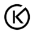 | **[Krepling](https://enercoruna-gif.github.io/disenomd/analisis/krepling/)** | Pagos | Composición asimétrica sobre blanco: titular grande abajo a la izquierda y objetos 3D flotando… |  | [DESIGN.md](docs/analisis/krepling/DESIGN.md) |
|  | **[Titan](https://enercoruna-gif.github.io/disenomd/analisis/titan/)** | Inversión | Héroe fotográfico a pantalla completa con el nombre de la marca en serif gigante y texto… |  | [DESIGN.md](docs/analisis/titan/DESIGN.md) |
|  | **[Better Stack](https://enercoruna-gif.github.io/disenomd/analisis/better-stack/)** | Desarrollo | Fondo azul noche casi negro con titular blanco grande y una captura del panel de producto… |  | [DESIGN.md](docs/analisis/better-stack/DESIGN.md) |
|  | **[Eraser](https://enercoruna-gif.github.io/disenomd/analisis/eraser/)** | Productividad | Blanco cálido con titular centrado enorme en sans gris oscuro y etiquetas de colores en línea… |  | [DESIGN.md](docs/analisis/eraser/DESIGN.md) |
|  | **[Healthy Together](https://enercoruna-gif.github.io/disenomd/analisis/healthy-together/)** | Salud | Azul marino profundo a toda la pantalla con titular blanco centrado en sans muy gruesa. |  | [DESIGN.md](docs/analisis/healthy-together/DESIGN.md) |
| 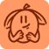 | **[Passionfroot](https://enercoruna-gif.github.io/disenomd/analisis/passionfroot/)** | Marketing | Titular centrado en serif expresiva sobre un cielo morado ilustrado con un personaje 3D. |  | [DESIGN.md](docs/analisis/passionfroot/DESIGN.md) |
|  | **[June](https://enercoruna-gif.github.io/disenomd/analisis/june/)** | Analítica | Fondo gris muy claro con titular negro centrado en una sans redondeada y muy gruesa. |  | [DESIGN.md](docs/analisis/june/DESIGN.md) |
|  | **[Endless Tools](https://enercoruna-gif.github.io/disenomd/analisis/endless-tools/)** | Diseño | Negro puro con titular blanco centrado, palabras rodeadas a mano y objetos 3D flotando… |  | [DESIGN.md](docs/analisis/endless-tools/DESIGN.md) |
| 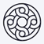 | **[Mercury](https://enercoruna-gif.github.io/disenomd/analisis/mercury/)** | Banca | Paisaje fotográfico de montaña bajo un titular blanco centrado, con un campo de correo y botón… |  | [DESIGN.md](docs/analisis/mercury/DESIGN.md) |
| 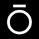 | **[Oura](https://enercoruna-gif.github.io/disenomd/analisis/oura/)** | Salud | Fondo crema cálido con titular en serif fina de gran tamaño y la foto del producto centrada. |  | [DESIGN.md](docs/analisis/oura/DESIGN.md) |
|  | **[DJI](https://enercoruna-gif.github.io/disenomd/analisis/dji/)** | Tecnología | Fotografía de producto a pantalla completa con el nombre del modelo en sans fina blanca… |  | [DESIGN.md](docs/analisis/dji/DESIGN.md) |

## 📚 Catálogo completo por sector

<b>Finanzas</b> · 10 webs

| | Web | Sector | Estilo | Paleta | Archivo |
|:-:|---|---|---|---|---|
|  | **[Krepling](https://enercoruna-gif.github.io/disenomd/analisis/krepling/)** | Pagos | Composición asimétrica sobre blanco: titular grande abajo a la izquierda y objetos 3D flotando… |  | [DESIGN.md](docs/analisis/krepling/DESIGN.md) |
|  | **[Titan](https://enercoruna-gif.github.io/disenomd/analisis/titan/)** | Inversión | Héroe fotográfico a pantalla completa con el nombre de la marca en serif gigante y texto… |  | [DESIGN.md](docs/analisis/titan/DESIGN.md) |
|  | **[Mercury](https://enercoruna-gif.github.io/disenomd/analisis/mercury/)** | Banca | Paisaje fotográfico de montaña bajo un titular blanco centrado, con un campo de correo y botón… |  | [DESIGN.md](docs/analisis/mercury/DESIGN.md) |
|  | **[Stripe](https://enercoruna-gif.github.io/disenomd/analisis/stripe/)** | Pagos | Degradados de colores fluidos detrás de un titular grande y oscuro, con cifras y logos de… |  | [DESIGN.md](docs/analisis/stripe/DESIGN.md) |
| 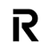 | **[Revolut](https://enercoruna-gif.github.io/disenomd/analisis/revolut/)** | Banca | Azul de marca con fotografía de estilo de vida y titulares blancos enormes. |  | [DESIGN.md](docs/analisis/revolut/DESIGN.md) |
|  | **[N26](https://enercoruna-gif.github.io/disenomd/analisis/n26/)** | Banca | Verde menta suave con titular centrado grande y fotografía de personas. |  | [DESIGN.md](docs/analisis/n26/DESIGN.md) |
|  | **[BBVA](https://enercoruna-gif.github.io/disenomd/analisis/bbva/)** | Banca | Banca clara y directa: azul corporativo profundo, cabeceras con cifras grandes y fotografía de… |  | [DESIGN.md](docs/analisis/bbva/DESIGN.md) |
| 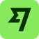 | **[Wise](https://enercoruna-gif.github.io/disenomd/analisis/wise/)** | Pagos | Verde lima brillante con titular en mayúsculas muy grueso en verde oscuro. |  | [DESIGN.md](docs/analisis/wise/DESIGN.md) |
|  | **[Monzo](https://enercoruna-gif.github.io/disenomd/analisis/monzo/)** | Banca | Azul marino oscuro con acentos coral, titulares grandes y fotografía de la tarjeta. |  | [DESIGN.md](docs/analisis/monzo/DESIGN.md) |
|  | **[PayPal](https://enercoruna-gif.github.io/disenomd/analisis/paypal/)** | Pagos | Azul cielo de fondo con titular negro enorme y muy grueso, y una tarjeta blanca con fotografía… |  | [DESIGN.md](docs/analisis/paypal/DESIGN.md) |

<b>Software y productividad</b> · 19 webs

| | Web | Sector | Estilo | Paleta | Archivo |
|:-:|---|---|---|---|---|
|  | **[Lattice](https://enercoruna-gif.github.io/disenomd/analisis/lattice/)** | Recursos humanos | Portada clara de software de RR. HH. con titular grande en sans geométrica a la izquierda y… |  | [DESIGN.md](docs/analisis/lattice/DESIGN.md) |
|  | **[Eraser](https://enercoruna-gif.github.io/disenomd/analisis/eraser/)** | Productividad | Blanco cálido con titular centrado enorme en sans gris oscuro y etiquetas de colores en línea… |  | [DESIGN.md](docs/analisis/eraser/DESIGN.md) |
|  | **[Passionfroot](https://enercoruna-gif.github.io/disenomd/analisis/passionfroot/)** | Marketing | Titular centrado en serif expresiva sobre un cielo morado ilustrado con un personaje 3D. |  | [DESIGN.md](docs/analisis/passionfroot/DESIGN.md) |
|  | **[June](https://enercoruna-gif.github.io/disenomd/analisis/june/)** | Analítica | Fondo gris muy claro con titular negro centrado en una sans redondeada y muy gruesa. |  | [DESIGN.md](docs/analisis/june/DESIGN.md) |
| 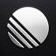 | **[Linear](https://enercoruna-gif.github.io/disenomd/analisis/linear/)** | Software | Modo oscuro casi negro, tipografía neutra muy afinada y capturas del producto con brillo sutil. |  | [DESIGN.md](docs/analisis/linear/DESIGN.md) |
|  | **[Notion](https://enercoruna-gif.github.io/disenomd/analisis/notion/)** | Productividad | Blanco con ilustraciones de trazo negro, titular grande y acentos de color puntuales. |  | [DESIGN.md](docs/analisis/notion/DESIGN.md) |
|  | **[Slack](https://enercoruna-gif.github.io/disenomd/analisis/slack/)** | Comunicación | Blanco con morado berenjena de marca, titulares muy gruesos y capturas del chat. |  | [DESIGN.md](docs/analisis/slack/DESIGN.md) |
|  | **[Intercom](https://enercoruna-gif.github.io/disenomd/analisis/intercom/)** | Atención al cliente | Titular centrado enorme en sans fina que combina gris claro y negro, rodeado de fotografías… |  | [DESIGN.md](docs/analisis/intercom/DESIGN.md) |
|  | **[Airtable](https://enercoruna-gif.github.io/disenomd/analisis/airtable/)** | Bases de datos | Portada corporativa centrada, con titular grande en una sans neutra y dos botones: uno sólido… |  | [DESIGN.md](docs/analisis/airtable/DESIGN.md) |
| 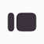 | **[Typeform](https://enercoruna-gif.github.io/disenomd/analisis/typeform/)** | Formularios | Fondo blanco, titular serif grande centrado y ejemplos de formularios en colores suaves. |  | [DESIGN.md](docs/analisis/typeform/DESIGN.md) |
|  | **[Holded](https://enercoruna-gif.github.io/disenomd/analisis/holded/)** | Gestión | Fondo oscuro azul noche con titular blanco grande y un botón blanco en píldora para el correo. |  | [DESIGN.md](docs/analisis/holded/DESIGN.md) |
|  | **[Factorial](https://enercoruna-gif.github.io/disenomd/analisis/factorial/)** | Recursos humanos | Blanco con acentos rojo frambuesa, titular centrado con palabras destacadas en color y… |  | [DESIGN.md](docs/analisis/factorial/DESIGN.md) |
|  | **[Miro](https://enercoruna-gif.github.io/disenomd/analisis/miro/)** | Colaboración | Fondo crema muy claro, amarillo de marca y lienzos de post-its como ilustración. |  | [DESIGN.md](docs/analisis/miro/DESIGN.md) |
|  | **[Raycast](https://enercoruna-gif.github.io/disenomd/analisis/raycast/)** | Productividad | Negro profundo con un gráfico rojo diagonal y titular blanco: aspecto de app nativa premium. |  | [DESIGN.md](docs/analisis/raycast/DESIGN.md) |
|  | **[Mailchimp](https://enercoruna-gif.github.io/disenomd/analisis/mailchimp/)** | Marketing | Amarillo cavendish de marca, titulares en serif propia con una palabra en cursiva y fotografía… |  | [DESIGN.md](docs/analisis/mailchimp/DESIGN.md) |
|  | **[Dropbox](https://enercoruna-gif.github.io/disenomd/analisis/dropbox/)** | Almacenamiento | Rejilla geométrica con mucho blanco, azul corporativo y capturas de producto ordenadas en… |  | [DESIGN.md](docs/analisis/dropbox/DESIGN.md) |
|  | **[Cal.com](https://enercoruna-gif.github.io/disenomd/analisis/cal/)** | Agenda | Interfaz en blanco y negro con una display redondeada propia y capturas de la agenda en… |  | [DESIGN.md](docs/analisis/cal/DESIGN.md) |
| 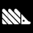 | **[PostHog](https://enercoruna-gif.github.io/disenomd/analisis/posthog/)** | Analítica | Crema y marrón con un estilo de escritorio retro, ventanas y personajes de erizo. |  | [DESIGN.md](docs/analisis/posthog/DESIGN.md) |
|  | **[Trello](https://enercoruna-gif.github.io/disenomd/analisis/trello/)** | Productividad | Blanco con azul de marca, titular grande a la izquierda e ilustración del móvil con tarjetas. |  | [DESIGN.md](docs/analisis/trello/DESIGN.md) |

<b>Desarrollo e IA</b> · 9 webs

| | Web | Sector | Estilo | Paleta | Archivo |
|:-:|---|---|---|---|---|
|  | **[Antimetal](https://enercoruna-gif.github.io/disenomd/analisis/antimetal/)** | Infraestructura | Fondo hueso casi blanco con titular centrado en serif fina y un único botón negro en píldora. |  | [DESIGN.md](docs/analisis/antimetal/DESIGN.md) |
|  | **[Better Stack](https://enercoruna-gif.github.io/disenomd/analisis/better-stack/)** | Desarrollo | Fondo azul noche casi negro con titular blanco grande y una captura del panel de producto… |  | [DESIGN.md](docs/analisis/better-stack/DESIGN.md) |
| 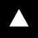 | **[Vercel](https://enercoruna-gif.github.io/disenomd/analisis/vercel/)** | Desarrollo | Blanco y negro con el triángulo de marca como único gráfico y titular muy ajustado. |  | [DESIGN.md](docs/analisis/vercel/DESIGN.md) |
|  | **[GitHub](https://enercoruna-gif.github.io/disenomd/analisis/github/)** | Desarrollo | Portada clara con titular negro grande, ilustración del octogato y campo de correo con botón… |  | [DESIGN.md](docs/analisis/github/DESIGN.md) |
|  | **[Supabase](https://enercoruna-gif.github.io/disenomd/analisis/supabase/)** | Desarrollo | Fondo blanco u oscuro según sistema, verde esmeralda de marca y capturas de consola. |  | [DESIGN.md](docs/analisis/supabase/DESIGN.md) |
| 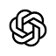 | **[OpenAI](https://enercoruna-gif.github.io/disenomd/analisis/openai/)** | Inteligencia artificial | Portada sobria y blanca con buscador central y tarjetas de imagen grandes y suaves. |  | [DESIGN.md](docs/analisis/openai/DESIGN.md) |
| 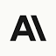 | **[Anthropic](https://enercoruna-gif.github.io/disenomd/analisis/anthropic/)** | Inteligencia artificial | Fondo crema cálido, titulares en serif y texto en sans: parece una editorial más que una… |  | [DESIGN.md](docs/analisis/anthropic/DESIGN.md) |
|  | **[Resend](https://enercoruna-gif.github.io/disenomd/analisis/resend/)** | Desarrollo | Negro total con una ilustración 3D en cristal y titular serif blanco. |  | [DESIGN.md](docs/analisis/resend/DESIGN.md) |
|  | **[Cursor](https://enercoruna-gif.github.io/disenomd/analisis/cursor/)** | Inteligencia artificial | Estética de editor de código: fondo claro y neutro, tipografía técnica y capturas grandes del… |  | [DESIGN.md](docs/analisis/cursor/DESIGN.md) |

<b>Diseño y creatividad</b> · 9 webs

| | Web | Sector | Estilo | Paleta | Archivo |
|:-:|---|---|---|---|---|
|  | **[Endless Tools](https://enercoruna-gif.github.io/disenomd/analisis/endless-tools/)** | Diseño | Negro puro con titular blanco centrado, palabras rodeadas a mano y objetos 3D flotando… |  | [DESIGN.md](docs/analisis/endless-tools/DESIGN.md) |
|  | **[Figma](https://enercoruna-gif.github.io/disenomd/analisis/figma/)** | Diseño | Colores planos muy saturados por bloques (verde, morado, naranja) y titulares enormes. |  | [DESIGN.md](docs/analisis/figma/DESIGN.md) |
|  | **[Medium](https://enercoruna-gif.github.io/disenomd/analisis/medium/)** | Publicación | Crema cálido, titular serif gigante y una ilustración verde de trazo libre. |  | [DESIGN.md](docs/analisis/medium/DESIGN.md) |
|  | **[LottieFiles](https://enercoruna-gif.github.io/disenomd/analisis/lottiefiles/)** | Animación | Fondo blanco, verde azulado de marca y personajes animados en colores primarios. |  | [DESIGN.md](docs/analisis/lottiefiles/DESIGN.md) |
| 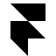 | **[Framer](https://enercoruna-gif.github.io/disenomd/analisis/framer/)** | Diseño | Fondo negro absoluto, titular blanco grande y efectos de luz azul: escaparate de animaciones. |  | [DESIGN.md](docs/analisis/framer/DESIGN.md) |
|  | **[Webflow](https://enercoruna-gif.github.io/disenomd/analisis/webflow/)** | Diseño | Blanco con azul eléctrico de marca y capturas del editor visual en tarjetas. |  | [DESIGN.md](docs/analisis/webflow/DESIGN.md) |
|  | **[Dribbble](https://enercoruna-gif.github.io/disenomd/analisis/dribbble/)** | Diseño | Blanco limpio con titular negro grande y una palabra destacada en rosa, al servicio de las… |  | [DESIGN.md](docs/analisis/dribbble/DESIGN.md) |
|  | **[Canva](https://enercoruna-gif.github.io/disenomd/analisis/canva/)** | Diseño | Degradados morado-turquesa muy vivos y titulares redondos y gruesos, pensado para un público… |  | [DESIGN.md](docs/analisis/canva/DESIGN.md) |
|  | **[Loom](https://enercoruna-gif.github.io/disenomd/analisis/loom/)** | Vídeo | Blanco con azul vivo de marca, titular centrado y miniaturas de vídeo como prueba del producto. |  | [DESIGN.md](docs/analisis/loom/DESIGN.md) |

<b>Tiendas y consumo</b> · 10 webs

| | Web | Sector | Estilo | Paleta | Archivo |
|:-:|---|---|---|---|---|
|  | **[Healthy Together](https://enercoruna-gif.github.io/disenomd/analisis/healthy-together/)** | Salud | Azul marino profundo a toda la pantalla con titular blanco centrado en sans muy gruesa. |  | [DESIGN.md](docs/analisis/healthy-together/DESIGN.md) |
|  | **[Oura](https://enercoruna-gif.github.io/disenomd/analisis/oura/)** | Salud | Fondo crema cálido con titular en serif fina de gran tamaño y la foto del producto centrada. |  | [DESIGN.md](docs/analisis/oura/DESIGN.md) |
|  | **[DJI](https://enercoruna-gif.github.io/disenomd/analisis/dji/)** | Tecnología | Fotografía de producto a pantalla completa con el nombre del modelo en sans fina blanca… |  | [DESIGN.md](docs/analisis/dji/DESIGN.md) |
|  | **[Apple](https://enercoruna-gif.github.io/disenomd/analisis/apple/)** | Tecnología | Bloques a pantalla completa alternando negro y gris muy claro, cada uno con un producto y un… |  | [DESIGN.md](docs/analisis/apple/DESIGN.md) |
|  | **[Mango](https://enercoruna-gif.github.io/disenomd/analisis/mango/)** | Moda | Fotografía de moda a sangre con titular serif blanco superpuesto y navegación mínima en… |  | [DESIGN.md](docs/analisis/mango/DESIGN.md) |
|  | **[Glovo](https://enercoruna-gif.github.io/disenomd/analisis/glovo/)** | Reparto | Amarillo intenso de fondo, ilustraciones 3D de comida y un buscador de dirección central. |  | [DESIGN.md](docs/analisis/glovo/DESIGN.md) |
| 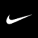 | **[Nike](https://enercoruna-gif.github.io/disenomd/analisis/nike/)** | Deporte | Fotografía deportiva a pantalla completa con titulares en mayúsculas condensadas y negras. |  | [DESIGN.md](docs/analisis/nike/DESIGN.md) |
| 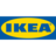 | **[IKEA](https://enercoruna-gif.github.io/disenomd/analisis/ikea/)** | Hogar | Azul y amarillo de marca solo en el logo y detalles; el resto es blanco con fotografía de… |  | [DESIGN.md](docs/analisis/ikea/DESIGN.md) |
|  | **[Shopify](https://enercoruna-gif.github.io/disenomd/analisis/shopify/)** | Comercio | Negro de fondo con fotografía cálida y titulares blancos en una sans propia. |  | [DESIGN.md](docs/analisis/shopify/DESIGN.md) |
|  | **[Mercadona](https://enercoruna-gif.github.io/disenomd/analisis/mercadona/)** | Supermercado | Verde corporativo con fotografía de producto fresco y un campo grande para el código postal. |  | [DESIGN.md](docs/analisis/mercadona/DESIGN.md) |

<b>Viajes y movilidad</b> · 5 webs

| | Web | Sector | Estilo | Paleta | Archivo |
|:-:|---|---|---|---|---|
|  | **[Airbnb](https://enercoruna-gif.github.io/disenomd/analisis/airbnb/)** | Viajes | Interfaz blanca y amable donde manda la fotografía: tarjetas de alojamiento con esquinas… |  | [DESIGN.md](docs/analisis/airbnb/DESIGN.md) |
|  | **[Cabify](https://enercoruna-gif.github.io/disenomd/analisis/cabify/)** | Movilidad | Morado característico con fotografía de conductores y pasajeros y titulares gruesos. |  | [DESIGN.md](docs/analisis/cabify/DESIGN.md) |
|  | **[Iberia](https://enercoruna-gif.github.io/disenomd/analisis/iberia/)** | Aerolínea | Fotografía de destino a pantalla completa con buscador de vuelos superpuesto y rojo… |  | [DESIGN.md](docs/analisis/iberia/DESIGN.md) |
|  | **[Booking.com](https://enercoruna-gif.github.io/disenomd/analisis/booking/)** | Viajes | Azul intenso en la cabecera con un buscador amarillo muy visible: todo empuja a buscar fechas. |  | [DESIGN.md](docs/analisis/booking/DESIGN.md) |
|  | **[Uber](https://enercoruna-gif.github.io/disenomd/analisis/uber/)** | Movilidad | Negro y blanco absoluto, titulares gruesos y formularios de origen y destino. |  | [DESIGN.md](docs/analisis/uber/DESIGN.md) |

<b>Medios y ocio</b> · 6 webs

| | Web | Sector | Estilo | Paleta | Archivo |
|:-:|---|---|---|---|---|
|  | **[Spotify](https://enercoruna-gif.github.io/disenomd/analisis/spotify/)** | Música | Negro y verde de marca con titulares enormes y gruesos, casi carteles. |  | [DESIGN.md](docs/analisis/spotify/DESIGN.md) |
|  | **[El País](https://enercoruna-gif.github.io/disenomd/analisis/el-pais/)** | Prensa | Cabecera de periódico clásica con logotipo serif centrado, columnas de noticias y fotografía… |  | [DESIGN.md](docs/analisis/el-pais/DESIGN.md) |
|  | **[Xataka](https://enercoruna-gif.github.io/disenomd/analisis/xataka/)** | Prensa | Fondo oscuro de portada con logotipo verde y rejilla densa de noticias tecnológicas. |  | [DESIGN.md](docs/analisis/xataka/DESIGN.md) |
|  | **[Duolingo](https://enercoruna-gif.github.io/disenomd/analisis/duolingo/)** | Educación | Verde lima, personajes ilustrados y botones con relieve inferior que parecen de juego. |  | [DESIGN.md](docs/analisis/duolingo/DESIGN.md) |
|  | **[Discord](https://enercoruna-gif.github.io/disenomd/analisis/discord/)** | Comunidad | Azul eléctrico saturado de fondo con ilustraciones de personajes y titulares en mayúsculas muy… |  | [DESIGN.md](docs/analisis/discord/DESIGN.md) |
|  | **[Twitch](https://enercoruna-gif.github.io/disenomd/analisis/twitch/)** | Streaming | Morado de marca con miniaturas de directos en rejilla densa y fondo gris muy claro. |  | [DESIGN.md](docs/analisis/twitch/DESIGN.md) |

## 🤝 ¿Echas en falta una web?

[Abre una petición](https://github.com/enercoruna-gif/disenomd/issues/new?title=Analizar%20la%20web%20de%20...) con la web que quieres ver analizada. Y si el catálogo te ahorra tiempo, **dale una ⭐ al repositorio**: así más gente lo encuentra.

## ⚖️ Aviso

Análisis independientes y sin afiliación. Los nombres, logotipos y marcas son de sus dueños y solo se citan para identificar la web analizada; las capturas son nuestras. Úsalos como referencia de estilo para tu propia web, con tus textos, tu logotipo y tus imágenes.

## 🧱 Cómo está hecho

- `src/sitios.json` + `src/rastreo.py`: lista de webs y rastreo con Playwright y Chrome, que hace las capturas (`docs/analisis/<slug>/captura.webp`) y extrae colores y tipografías a `src/analisis/<slug>.json`.
- `src/notas_analisis.py` y `src/analisis_web.py`: textos de cada análisis y generación de sus DESIGN.md.
- `src/build.py`: genera la web en `docs/` y este README (`python3 src/build.py`).
- `src/logos/`: logotipos de [Simple Icons](https://simpleicons.org) (CC0).
- Validación: `npx @google/design.md lint docs/analisis/*/DESIGN.md`.
- Publicación gratis con GitHub Pages desde `docs/` en `main`.
